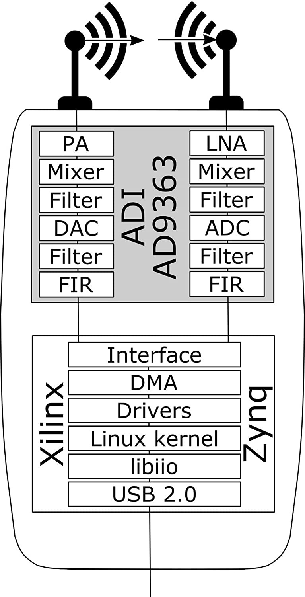
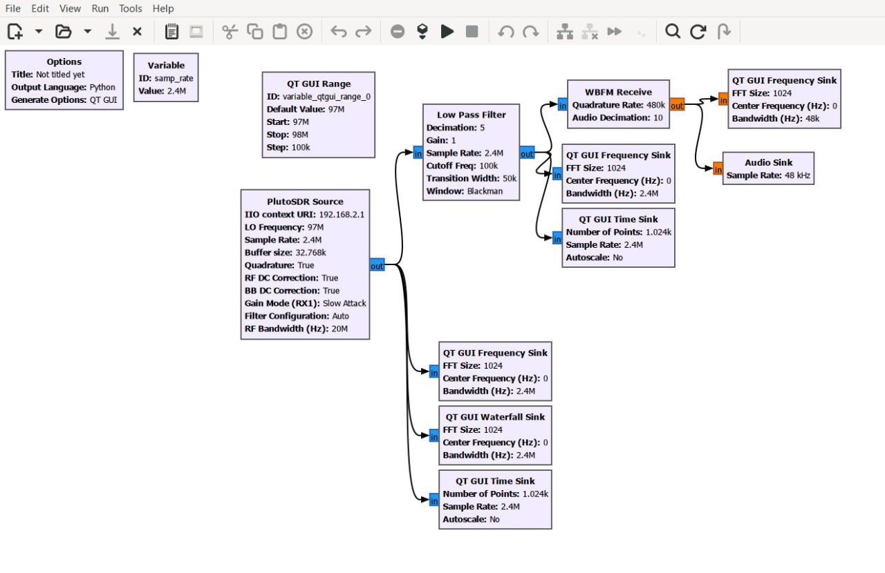
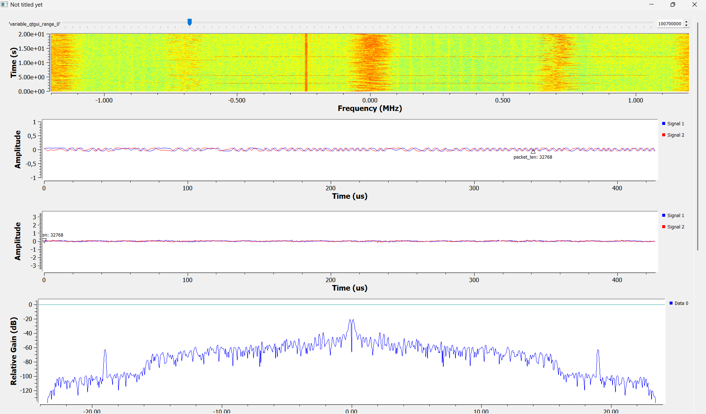
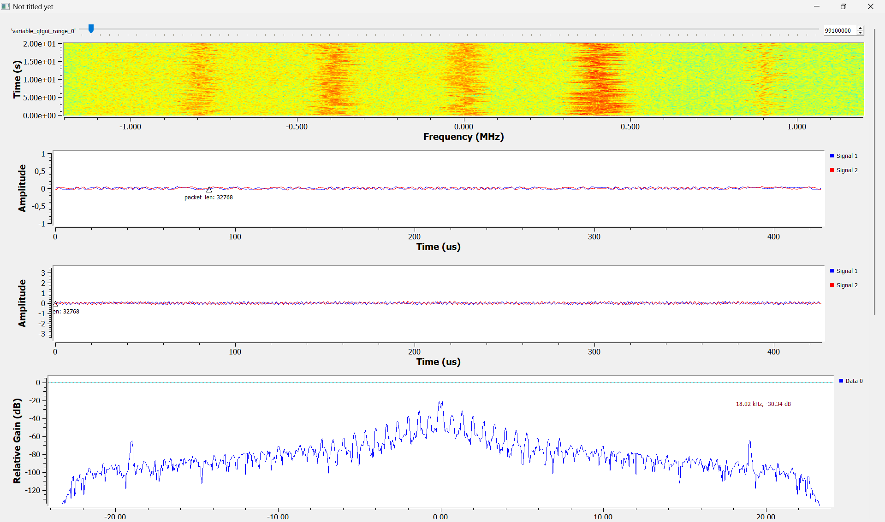

## Тема практической работы: Архитектура Adalm Pluto SDR. GNU Radio. Построение радио-приёмника

Занятия: 08.09.26 и 15.09.26.

### Цель работы:

1. Изучить, как устроен Adalm Pluto SDR.
2. Установить GNU Radio Companion и разобраться с его блоками.
3. Собрать радиоприёмник на Adalm Pluto SDR.

### Теория:

GNU Radio - это инструмент с открытым исходным кодом для разработки программно-определяемого радио. В GNU Radio Companion можно собрать обработку сигнала из готовых блоков и запустить её с SDR-устройством, например Adalm Pluto.

Блоки выполняют приём, фильтрацию, демодуляцию и вывод сигнала. GNU Radio использует C++ и Python; программы можно создавать через API или графический редактор GNU Radio Companion.

  

### Выполнение работы:

После лекции об устройстве Adalm Pluto перешли к практике. Я установил программы и драйверы, затем начал собирать радиоприёмник из блоков.

Для сборки радиоприемника мне понадобились следующие блоки:

1. PlutoSDR Source принимает сигнал с Adalm Pluto. В нём задаются частота FM-станции и частота дискретизации.
2. QT GUI Frequency Sink показывает спектр относительно центральной частоты приёма.
3. Low Pass Filter выделяет нужную полосу сигнала.
4. QT GUI Time Sink показывает, как сигнал меняется во времени.
5. WBFM Receive демодулирует широковещательный FM-сигнал.
6. Audio Sink выводит звук в динамики или наушники ПК.
7. Дополнительные блоки, например ползунок, позволяют менять частоту во время работы.

  

После нескольких попыток и замены Adalm Pluto я смог поймать сигнал и послушать радио.

  

  

### Вывод:

Я разобрался с устройством Adalm Pluto SDR и собрал FM-приёмник в GNU Radio Companion. С первого раза принять станцию не получилось. После нескольких попыток и замены платы удалось услышать радио и посмотреть сигнал на графиках.

