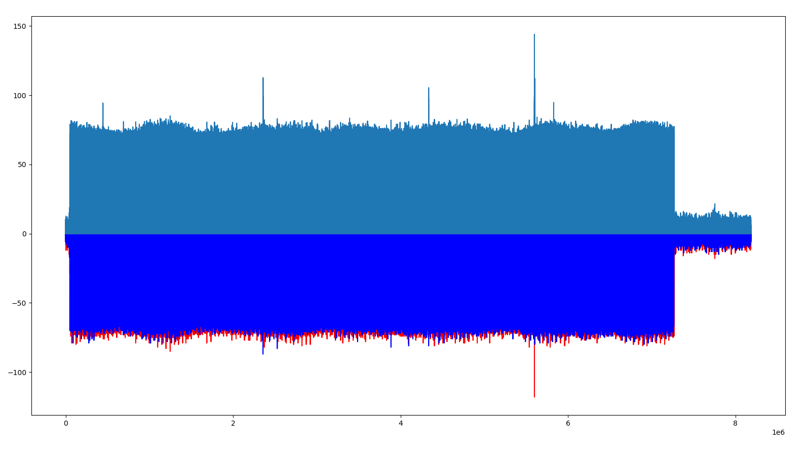
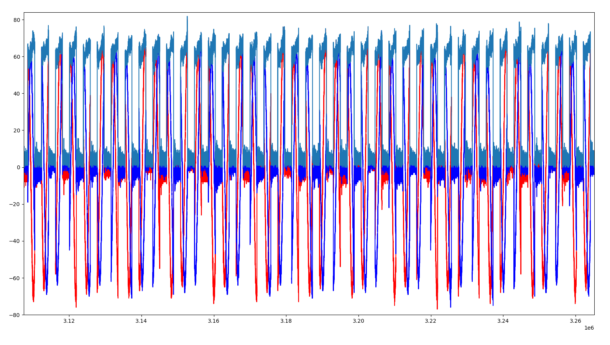
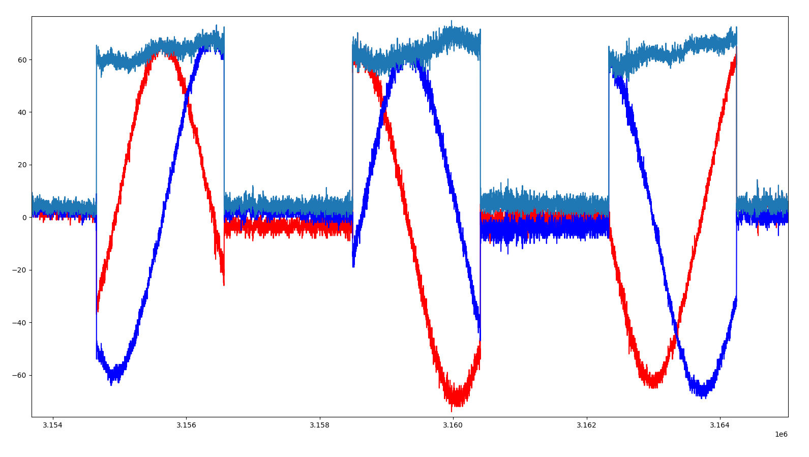

## Тема практической работы: Приём и передача сигнала на двух Adalm Pluto SDR

Занятия: 22.09.26–20.10.26. Обмен между двумя устройствами относится к этапу 06.10.26–20.10.26.

### Цель работы:

1. Настроить приём и передачу между двумя устройствами Adalm Pluto SDR через SoapySDR.
2. Передать сигнал в виде «полочек» и сохранить принятые данные.
3. Посмотреть на графиках, как меняются составляющие сигнала I и Q.

### Теория:

При обмене между двумя SDR передатчик одного настраивают на частоту приёмника другого. Для передачи в обратную сторону можно использовать вторую частоту.

Чтобы получить «полочку», на время передачи задают постоянные значения I и Q. Принятый сигнал тоже записывается в виде I и Q. По графикам можно увидеть отдельные посылки и паузы между ними.

### Выполнение работы:

Для работы с двумя Pluto я использовал программу на C++ с библиотекой SoapySDR. На обоих устройствах она принимает и передаёт сигнал. При запуске выбирается режим `rx` или `tx` и указывается USB-адрес нужного устройства.

В режиме `rx` устройство принимает на 800 МГц и передаёт на 850 МГц. Для второго устройства выбирается режим `tx`, в котором эти частоты меняются местами. Частоту дискретизации я установил равной 1 МГц.

Для тестового сигнала я задал одинаковые постоянные значения I и Q в основной части передаваемого блока. На приёме я ожидал увидеть «полочки». Программа отправляет блоки с паузами, задавая время отправки на 4 мс позже времени принятого блока.

Принятые данные сохраняются в `rxdata.pcm` и `txdata.pcm`. Так записи с двух устройств можно просматривать отдельно.

По сохранённым данным я построил графики I и Q. Сначала посмотрел всю запись, но в таком масштабе линии почти сливаются и отдельные посылки разобрать трудно.

  

На увеличенном участке стали видны отдельные посылки и паузы между ними.

  

Я увеличил масштаб ещё раз. Здесь видно, что вместо ожидаемых «полочек» получились синусоидальные участки. Между посылками значения остаются около нуля.

  

### Вывод:

Я настроил приём и передачу между двумя Adalm Pluto SDR и сохранил данные с каждого устройства. Получить ожидаемые «полочки» на приёме пока не удалось: на графиках видны синусы. Причину этого ещё нужно выяснить.
