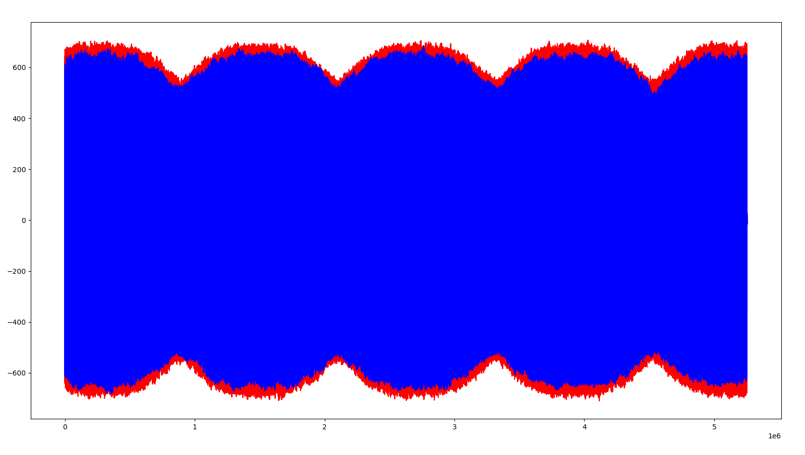
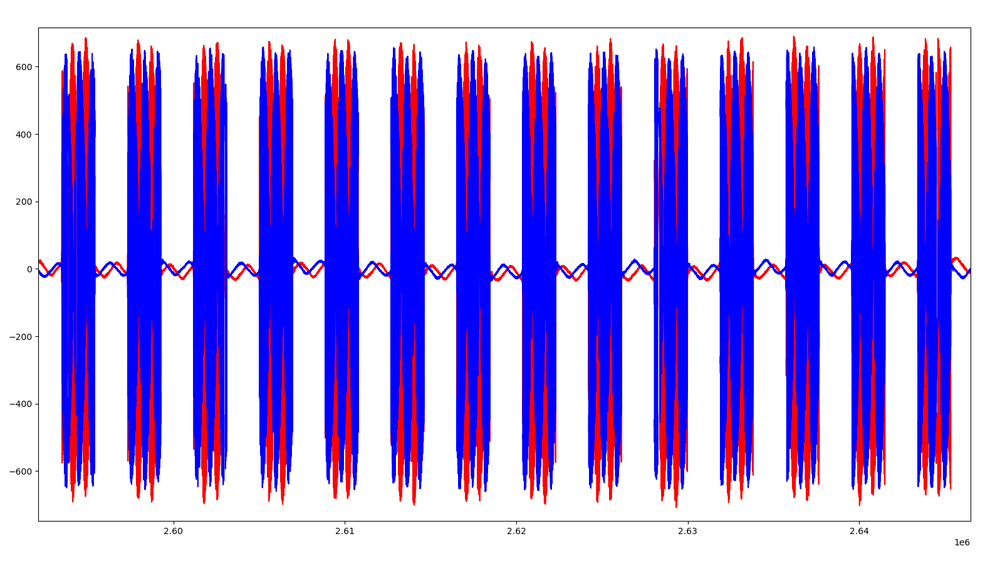
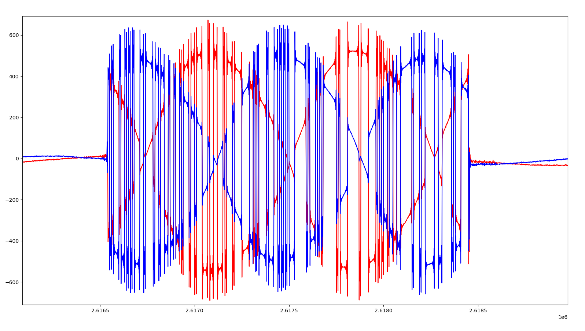
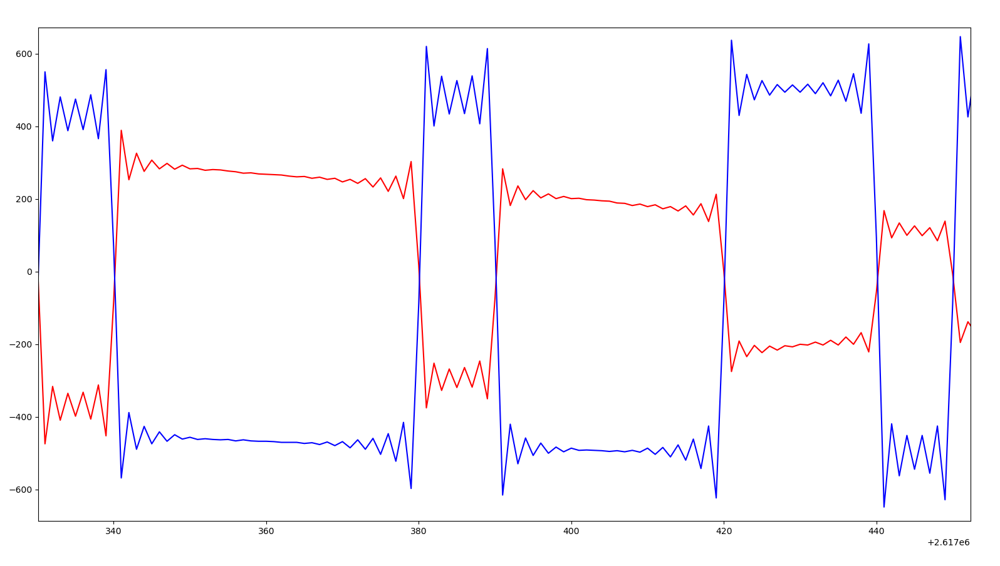

## Тема практической работы: Формирование и передача BPSK/QPSK-сигнала

Занятия: 27.10.26 и 03.11.26.

### Цель работы:

1. Сформировать последовательность битов и преобразовать её в BPSK- и QPSK-символы.
2. Увеличить число отсчётов на символ и выполнить свёртку с формирующим фильтром.
3. Подготовить IQ-отсчёты для передачи через Adalm Pluto SDR и рассмотреть сохранённые графики приёма.

### Теория:

Передатчик преобразует биты в комплексные символы `I + jQ`. В BPSK один символ передаёт один бит: в используемом коде биту `0` соответствует `I = −A`, а биту `1` соответствует `I = +A`. Составляющая Q равна нулю. Получаются две точки на оси I с противоположными фазами.

В QPSK один символ передаёт два бита. Первый задаёт знак I, второй задаёт знак Q. При амплитуде каждой составляющей `A` возможны четыре сочетания:

| Биты | I | Q |
|:-:|:-:|:-:|
| 00 | −A | −A |
| 01 | −A | +A |
| 10 | +A | −A |
| 11 | +A | +A |

На один символ приходится несколько отсчётов. Сначала делаем upsampling: вставляем нули между соседними символами. При `SPS = 10` за каждым символом идут девять нулевых комплексных отсчётов.

Затем пропускаем последовательность через формирующий фильтр. В этой работе все его коэффициенты равны единице: `h = {1, 1, 1, 1, 1, 1, 1, 1, 1, 1}`. Свёртку считаем отдельно для I и Q:

```text
y[n] = Σ h[k] · x[n − k],  k = 0, …, SPS − 1.
```

Отсчёты до начала входной последовательности считаются нулевыми. После вставки нулей такой фильтр растягивает каждый символ в прямоугольный импульс длиной десять отсчётов. Это простой способ получить «полочки» на передаче.

### Выполнение работы:

#### 1. Подготовка символов

Код модуляции находится в [src/modulate.cpp](../src/modulate.cpp), а настройки в [include/config.h](../include/config.h). Амплитуда в настройках равна `1500`, на символ приходится `10` отсчётов. Параметр `mode` выбирает BPSK (`0`) или QPSK (`1`). По умолчанию включена BPSK.

Функция `gen_bits` заполняет массив псевдослучайными нулями и единицами. Функции `bpsk` и `qpsk` переводят их в символы. В буфере значения чередуются: `I0, Q0, I1, Q1, …`. Поэтому для хранения N комплексных символов нужны 2N чисел типа `int16_t`.

#### 2. Upsampling и свёртка

Функция `upsample` размещает символы через каждые десять комплексных отсчётов и заполняет промежутки нулями. Функция `convolve` суммирует произведения входных отсчётов на коэффициенты фильтра отдельно для двух составляющих.

Например, для BPSK биты `1, 0, 1` дают символы `+1500, −1500, +1500` по оси I. После upsampling между ними стоят нули, а после свёртки каждое значение занимает десять отсчётов. Q остаётся нулевой. В QPSK так же обрабатываются обе составляющие.

При частоте дискретизации 1 МГц и `SPS = 10` внутри посылки получаем 100 тысяч символов в секунду. Для BPSK это 100 кбит/с, для QPSK 200 кбит/с. Это расчёт по настройкам: из-за пауз и служебных данных средняя скорость передачи полезных битов будет ниже.

#### 3. Подготовка передачи

В [src/tx_rx.cpp](../src/tx_rx.cpp) режим `tx` последовательно вызывает генерацию битов, модуляцию, upsampling и свёртку. Перед копированием в передающий буфер программа сдвигает значения на четыре разряда для используемого формата отсчётов. Начало буфера занимают служебные слова и временная метка.

Первое устройство принимает на 800 МГц и передаёт на 850 МГц, а у второго частоты меняются местами. Программа назначает передачу на 4 мс позже временной метки принятого блока и отправляет данные на каждой второй итерации цикла. В зависимости от режима принятые отсчёты попадают в `rxdata.pcm` или `txdata.pcm`.

#### 4. Разбор графиков

Сначала посмотрел общий график I и Q. На нём видны изменения уровня сигнала, но отдельные символы сливаются.

<p align="center">
  
</p>

Увеличил участок записи. Здесь уже можно различить посылки и паузы между ними; в паузах амплитуда заметно ниже.

<p align="center">
  
</p>

Затем приблизил одну посылку. I и Q быстро меняются, а их общий уровень меняется медленнее.

<p align="center">
  
</p>

При ещё большем увеличении видны переходы между уровнями и участки, похожие на «полочки». На границах остаются выбросы и колебания.

<p align="center">
  
</p>

На приёме I и Q отличаются от прямоугольных импульсов в передающем буфере. На форму влияют радиоканал, фильтры устройств и рассогласование передатчика с приёмником. По одним картинкам я не могу определить, что именно даёт каждое искажение. Проверить восстановление битов тоже пока нельзя: сначала нужно обработать принятый сигнал и сравнить биты с переданной последовательностью.

### Вывод:

Разобрал, как программа формирует передающий буфер: модулирует биты через BPSK/QPSK, вставляет нули и считает свёртку. Теперь понятно, как из отдельных символов получаются импульсы нужной длительности. На графиках рассмотрел посылки и переходы между уровнями. Дальше нужно заняться приёмником: отфильтровать сигнал, выбрать символьные отсчёты и восстановить биты.
