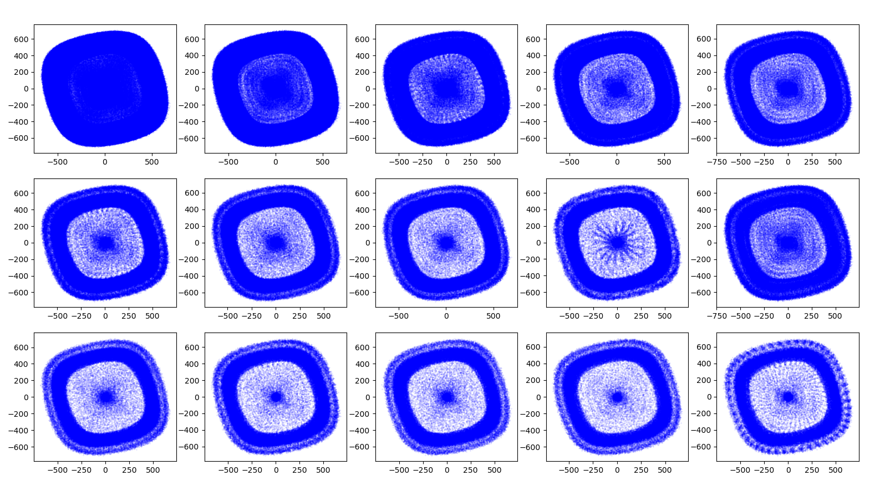

## Тема практической работы: Начало приёмника и разбиение SDR-проекта на модули

Занятия: 03.11.26 и 10.11.26. Проект разбили на модули в основном 10.11.26.

### Цель работы:

1. Разобрать обработку сигнала на приёмной стороне: фильтрацию, выбор символьных отсчётов и демодуляцию.
2. Рассмотреть диаграммы I/Q и определить, чего не хватает для восстановления битов.
3. Разделить программу на модули и подготовить структуру для дальнейшей визуализации через ImGui и ImPlot.

### Теория:

Приёмник получает поток комплексных отсчётов. Даже если в передатчике используются BPSK или QPSK, на приёме точки не обязаны сразу совпасть с идеальным созвездием. Между устройствами могут отличаться фаза и частота, а начало символа не обязано совпадать с началом принятого буфера.

Согласованный фильтр подбирают под форму переданного импульса. Для этого характеристику формирующего фильтра разворачивают во времени и комплексно сопрягают. У прямоугольного фильтра из десяти единичных коэффициентов после этих действий ничего не меняется. На приёме он суммирует десять последовательных отсчётов. Если нужно сохранить масштаб, результат делят на десять.

После фильтрации нужно выбрать один отсчёт на символ. При `SPS = 10` есть десять начальных смещений: от 0 до 9. Чтобы брать каждый десятый отсчёт, сначала нужно найти подходящее смещение и учесть задержку фильтра. На длинной записи придётся следить, не уходит ли символьная синхронизация.

На диаграмме созвездия по горизонтали откладывают I, по вертикали Q. После синхронизации у BPSK должны получиться две группы точек, у QPSK четыре. Когда фазовый поворот скомпенсирован, биты можно определять по знакам нужных составляющих.

### Выполнение работы:

#### 1. Разбор приёмной части

В текущей версии [src/tx_rx.cpp](../src/tx_rx.cpp) приёмный поток SoapySDR работает в формате `CS16`. Один комплексный отсчёт состоит из двух знаковых 16-битных чисел: I и Q. В файле они записываются поочерёдно без заголовка.

Функция `readStream` возвращает число полученных комплексных отсчётов. Столько пар I/Q и нужно записать в файл. Если записать весь буфер после неполного чтения, в файл попадут старые значения. При ошибке функция возвращает отрицательный код, который нельзя использовать как длину данных.

Запись смотрю через [src/plot.py](../src/plot.py). Скрипт выделяет I и Q и считает модуль комплексного сигнала. По модулю удобно искать посылки и паузы: поворот фазы сам по себе не меняет `sqrt(I² + Q²)`.

В материалах проекта есть и диаграммы I/Q:

  

Вместо двух или четырёх компактных групп на них видны широкие замкнутые области. По такому созвездию символы пока не прочитать. Сначала нужно отфильтровать сигнал, синхронизироваться и выбрать отсчёты в пределах символа. Параметры обработки на изображении не подписаны, поэтому я не могу связать отдельные диаграммы с конкретными смещениями.

#### 2. Разделение программы

Когда в программе появились модуляция и фильтрация, работать с одним большим файлом стало неудобно. Код разделён так:

| Файл | Назначение |
|---|---|
| [src/main.cpp](../src/main.cpp) | Чтение аргументов запуска и выбор режима `rx` или `tx` |
| [src/sdr.cpp](../src/sdr.cpp) | Создание устройства PlutoSDR через SoapySDR |
| [src/tx_rx.cpp](../src/tx_rx.cpp) | Настройка частот и потоков, приём, передача и запись отсчётов |
| [src/modulate.cpp](../src/modulate.cpp) | Генерация битов, BPSK/QPSK, upsampling и свёртка |
| [include/config.h](../include/config.h) | Частоты, амплитуда, SPS, режим модуляции и коэффициенты фильтра |

Объявления функций теперь лежат в заголовках `sdr.h`, `tx_rx.h` и `modulate.h`. Корневой [CMakeLists.txt](../CMakeLists.txt) собирает четыре исходных файла и подключает каталог `include`. В `main.cpp` остался запуск программы, а обработка сигнала и работа с устройством находятся в отдельных файлах.

#### 3. Подготовка визуализации

В проект добавлены сабмодули `thirdparty/imgui` и `thirdparty/implot`. Через ImGui можно сделать элементы интерфейса, через ImPlot вывести графики. Планирую показывать I/Q во времени, модуль сигнала и созвездие выбранных символьных отсчётов.

Пока в проекте есть только сабмодули библиотек. В сборку приложения они ещё не включены, окна интерфейса тоже нет. Данные по-прежнему смотрю отдельным Python-скриптом после записи файла.

До обработки на приёме тоже ещё не дошёл. Функция `convolve` сейчас вызывается только в передающей цепочке. В цикле приёма нужно добавить согласованный фильтр, выбор одного отсчёта на символ и демодулятор. На этих занятиях разобрал, как это должно работать, и подготовил структуру проекта.

### Вывод:

Теперь запуск, настройка SDR, обмен данными и формирование сигнала находятся в отдельных модулях. По диаграммам I/Q разобрал, какой обработки пока не хватает на приёме. Следом нужно добавить фильтрацию и синхронизацию, затем заняться окном ImGui с графиками ImPlot.
